# Kalupi ERD

```mermaid
erDiagram
    PROFILES ||--o{ CATEGORIES : owns
    PROFILES ||--o{ ACCOUNTS : holds
    ACCOUNTS ||--o{ TRANSACTIONS : "paid from / into"
    ACCOUNTS ||--o{ PRESETS : "defaults to"
    PROFILES ||--o{ BUDGETS : plans
    PROFILES ||--o{ TRANSACTIONS : records
    PROFILES ||--o{ PRESETS : saves
    PROFILES ||--o{ TRACKER_MEMBERS : joins
    PROFILES ||--o{ TRACKER_INVITES : sends

    BUDGETS ||--o{ BUDGET_ITEMS : contains
    CATEGORIES ||--o{ BUDGET_ITEMS : "limited by"
    CATEGORIES ||--o{ TRANSACTIONS : classifies
    CATEGORIES ||--o{ PRESETS : classifies

    TRACKERS ||--o{ TRACKER_MEMBERS : has
    TRACKERS ||--o{ TRACKER_INVITES : has
    TRACKERS ||--o{ TRANSACTIONS : "funded by"
    TRACKERS ||--o{ PRESETS : "funded by"
    TRACKERS ||--o{ SPLIT_PEOPLE : "settles with"
    SPLIT_PEOPLE ||--o{ SPLIT_SHARES : "owes / is owed"
    TRANSACTIONS ||--o{ SPLIT_SHARES : "split into"
    CATEGORIES ||--o{ SPLIT_SHARES : "your share counts toward"

    PROFILES {
        uuid id PK "same id as auth.users"
        text display_name
        text avatar_url "nullable, public URL in the avatars bucket"
        timestamptz created_at
    }

    ACCOUNTS {
        uuid id PK
        uuid user_id FK
        text name "e.g. BPI, GCash, Wallet"
        text kind "cash | bank | ewallet"
        timestamptz archived_at "null = active"
        timestamptz created_at
        timestamptz updated_at "set by server, used as sync cursor"
        timestamptz deleted_at "null = live, soft delete for sync"
    }

    CATEGORIES {
        uuid id PK
        uuid user_id FK
        text name
        text kind "income | expense"
        text icon "nullable, icon key; null = picked from the name"
        text color "nullable, color key; null = picked from the name"
        timestamptz archived_at "null = active"
        timestamptz updated_at "set by server, used as sync cursor"
        timestamptz deleted_at "null = live, soft delete for sync"
    }

    BUDGETS {
        uuid id PK
        uuid user_id FK
        date month "first day of month, null = default template"
        bigint total_limit "centavos, nullable: custom overall limit"
        timestamptz created_at
        timestamptz updated_at "set by server, used as sync cursor"
        timestamptz deleted_at "null = live, soft delete for sync"
    }

    BUDGET_ITEMS {
        uuid id PK
        uuid budget_id FK
        uuid category_id FK
        bigint limit_amount "centavos"
        timestamptz updated_at "set by server, used as sync cursor"
        timestamptz deleted_at "null = live, soft delete for sync"
    }

    TRANSACTIONS {
        uuid id PK
        uuid user_id FK "who paid or received"
        text type "income | expense | contribution | withdrawal | transfer | settle_in | settle_out"
        bigint amount "centavos, always positive"
        uuid account_id FK "account used; source account for transfers"
        uuid to_account_id FK "transfer only: destination account"
        uuid category_id FK "income and expense only"
        uuid tracker_id FK "contribution, withdrawal, settle_in/out; on an expense = a split bill"
        date occurred_on
        text note
        text source "manual | preset | scan"
        timestamptz created_at
        timestamptz updated_at "set by server, used as sync cursor"
        timestamptz deleted_at "null = live, soft delete for sync"
    }

    PRESETS {
        uuid id PK
        uuid user_id FK
        text name
        text type "same values as transactions.type"
        bigint amount "centavos"
        uuid account_id FK "nullable, default account"
        uuid category_id FK "nullable"
        uuid tracker_id FK "nullable"
        timestamptz archived_at "null = active"
        timestamptz updated_at "set by server, used as sync cursor"
        timestamptz deleted_at "null = live, soft delete for sync"
    }

    TRACKERS {
        uuid id PK
        text name
        text kind "goal | split"
        bigint target_amount "centavos; null for split"
        date target_date "nullable"
        uuid created_by FK
        timestamptz archived_at "null = active"
        timestamptz created_at
        timestamptz updated_at "set by server, used as sync cursor"
        timestamptz deleted_at "null = live, soft delete for sync"
    }

    TRACKER_MEMBERS {
        uuid tracker_id PK, FK
        uuid user_id PK, FK
        text role "owner | editor"
        timestamptz joined_at
        timestamptz updated_at "set by server, used as sync cursor"
        timestamptz deleted_at "null = live, soft delete for sync"
    }

    SPLIT_PEOPLE {
        uuid id PK
        uuid tracker_id FK
        uuid user_id FK "who keeps the list"
        text name "just a name, not an account"
        timestamptz created_at
        timestamptz updated_at "set by server, used as sync cursor"
        timestamptz deleted_at "null = live, soft delete for sync"
    }

    SPLIT_SHARES {
        uuid id PK
        uuid user_id FK
        uuid tracker_id FK
        uuid person_id FK
        uuid transaction_id FK "nullable: your bill or a payback"
        uuid category_id FK "nullable: only on a bill a friend paid"
        bigint amount "centavos; + they owe you, - you owe them"
        date occurred_on
        text note
        timestamptz created_at
        timestamptz updated_at "set by server, used as sync cursor"
        timestamptz deleted_at "null = live, soft delete for sync"
    }

    TRACKER_INVITES {
        uuid id PK
        uuid tracker_id FK
        uuid invited_by FK
        text token UK "random, goes in the invite link"
        uuid accepted_by FK "nullable"
        timestamptz expires_at
        timestamptz accepted_at "nullable"
        timestamptz revoked_at "nullable"
        timestamptz created_at
    }

```

## Derived values (never stored)

- **Account balance** = income − expense + transfers in − transfers out + settle_in − settle_out, for that account.
- **Available balance** = sum of the user's account balances − (contributions − withdrawals). Contributions earmark money for a tracker; it stays in its account.
- **Monthly budget total** = the budget's `total_limit` when the user set one, otherwise the sum of its `budget_items.limit_amount`.
- **Spent this month** = sum of all expense transactions in the month, compared against the total. For split bills only your share counts (see Settle-up).
- **Spent in a category this month** = sum of expense transactions in that category with `occurred_on` in the month, same rule.
- **Tracker progress** = contribution − withdrawal, over all members' transactions on that tracker.
- **What someone owes you** (settle-up) = sum of their `split_shares.amount`; negative = you owe them.

## Settle-up trackers (v1.0.3)

- **You paid a bill:** one expense for the full amount from your account (with `tracker_id`), plus a share per friend (+their part). Your budget counts the expense minus those shares.
- **A friend paid:** no transaction. One share on the payer (−your part) with the category it counts toward; your budget counts your part on that date.
- **Paybacks:** `settle_in` (they paid you) or `settle_out` (you paid them), from or into an account, plus a share that moves their balance toward zero. Never income or spending.
- Deleting a bill or payback deletes its shares. People are removed only once their balance is zero.
- Settle-up trackers are personal for now: no invites, and the people are names only.

## Sync (offline support)

- The app reads and writes a local copy in IndexedDB, so it works without a connection.
- Every local change is also queued in an outbox; when the device is online, the outbox is pushed to Supabase in order.
- Each device then pulls rows whose `updated_at` is newer than its last sync, including soft-deleted ones.
- IDs are UUIDs generated on the device, so offline-created rows never collide.
- Rows are never hard-deleted; deleting sets `deleted_at` so other devices learn about it.
- Conflicts resolve as last write wins (the change that reaches the server last).

## Rules

- A budget is unique per `(user_id, month)`; each user has one template row where `month` is null.
- Opening a month with no budget copies the template's items into a new budget for that month.
- A budget has at most one item per category.
- The setup wizard asks for each account's starting balance and records it as an income transaction into that account, in an "Opening balance" category.
- A transaction always has an account. Income/expense also have a category; contribution/withdrawal a tracker; transfer a different destination account.
- Anyone can sign up. A new account starts with no access to anyone else's data.
- Sharing a tracker: a member creates an invite, sends its link (e.g. over Messenger), and whoever opens it while logged in becomes an `editor` member. Links expire and can be revoked.
- Invites are by link, not by typing an email, so the app never reveals whether an email has an account. `invite_details()` shows the tracker name and sender on the invite page before joining.
- Members see each other's tracker totals (from `tracker_progress()`, cached on the device), never each other's entries.
- Withdrawals are limited to what that person put in. Leaving a tracker withdraws your share first; the owner can't leave, only archive.
